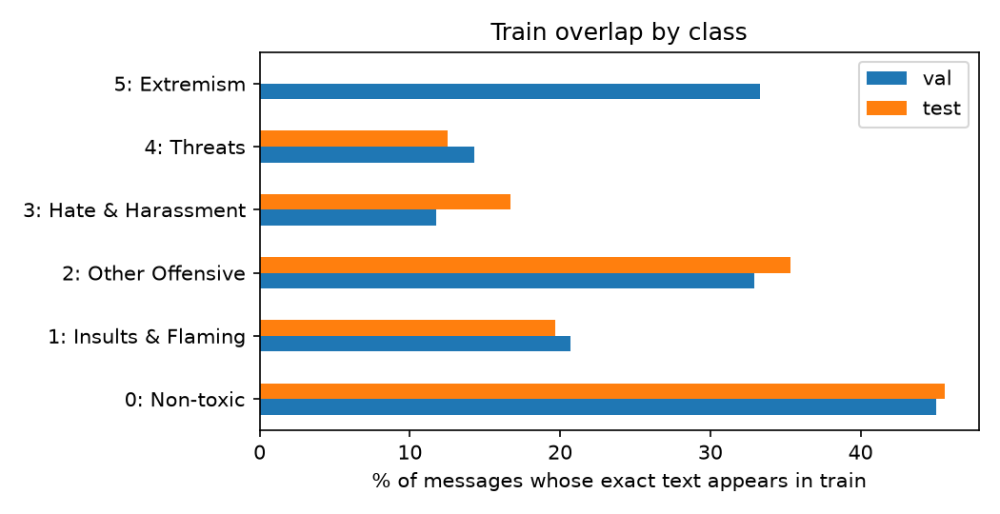
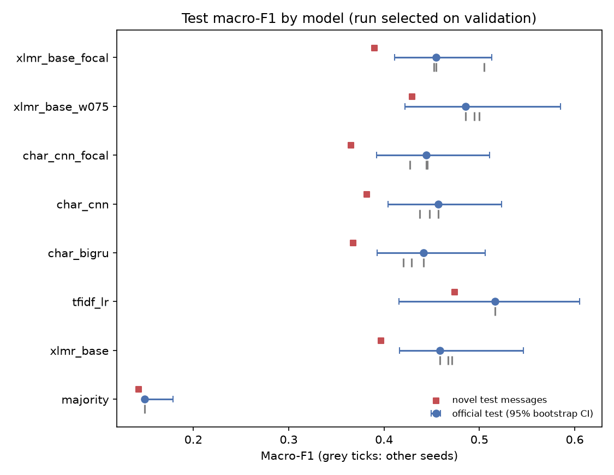
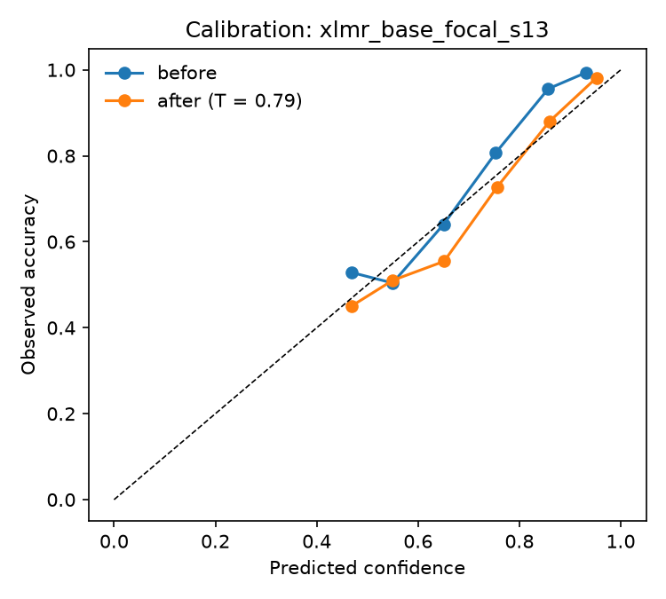

# Toxicity detection in game chat

**Does a general-purpose toxicity model work on game chat? Does a model trained on one
game work on another? And what can a public benchmark actually tell us?**

Six-class toxicity detection on World of Tanks chat ([GameTox](data/README.md)), from a
TF-IDF baseline to character-level networks written from scratch in PyTorch and a
multilingual transformer (XLM-RoBERTa) fine-tuned with a custom training loop. The
evaluation focuses on uncertainty: bootstrap confidence intervals, seed variability, paired
model comparisons, calibration and a moderation policy. The models are then applied,
without retraining, to Dota 2 chat ([CONDA](data/README.md)).

> **Content warning:** the data contain insults and hate speech. Examples are masked.

## Key findings

1. **General-purpose toxicity models fail on game chat.** On toxic vs non-toxic, off-the-shelf
   models reach an AUROC of 0.80–0.84; every model trained on game chat reaches 0.93–0.95,
   including a TF-IDF baseline.
2. **The benchmark cannot rank the models by macro-F1.** Two of the six classes (Threats,
   Extremism) have only **11 test messages** between them, so a third of the metric depends
   on 11 predictions. The test-set bootstrap SD (0.03–0.05) is larger than the gaps between
   models, and no model is significantly better than TF-IDF in paired tests.
3. **Selecting on a noisy validation set inflates scores.** Neural models score 0.59–0.62
   macro-F1 on validation and 0.43–0.49 on test: picking the best epoch and run on a
   validation set with 3 Extremism messages rewards noise.
4. **Where the data allow a comparison, XLM-R is best:** highest F1 on the four frequent
   classes, highest binary AUROC, and a much smaller gap in Russian and German than the
   character-level models.
5. **Game-specific training barely transfers to another game.** On Dota 2, XLM-R drops from
   0.95 to 0.83 AUROC, while a generic model that never saw game chat reaches 0.81. No model
   detects implicit toxicity (recall ≤ 13% vs 70–86% for explicit toxicity).
6. **Not deployable for automatic moderation.** Reaching ~90% recall requires sending a quarter
   of all chat to human review; a 95%-precision automatic band catches almost nothing.

## Data audit

| | Train | Val | Test |
|---|---:|---:|---:|
| Messages | 42,959 | 5,367 | 5,375 |
| Duplicate rows (same text) | 35.6% | 23.5% | 23.4% |
| Text also present in train | — | 40.9% | 41.3% |
| Threats / Extremism | 60 / 24 | 7 / 3 | 8 / 3 |

- **Overlap with train.** 41% of test messages have exactly the same text as a training message,
  mostly short chat such as "gg" (2,674 times in train) or "lol". They can be solved by memorisation,
  so every model is also evaluated on the **novel** test messages.
- **Annotation conflicts.** 299 distinct texts appear with different labels; they cover 14.5% of
  training rows.
- **A spreadsheet artefact.** `#error!` appears 137 times in train: an Excel error value that ended up
  in the dataset as a chat message.
- **Languages.** 63% English, 14% too short to identify, then Russian, German, Polish and others (langid).



## Models

| Model | Type | Parameters | Training |
|---|---|---:|---|
| Majority class | baseline | — | — |
| TF-IDF + logistic regression | baseline | 63k features | char 2–5-grams + word 1–2-grams, C chosen on validation |
| Generic toxic-bert / multilingual XLM-R | off-the-shelf | 110M / 278M | none (binary output only) |
| Character CNN | PyTorch, from scratch | 123k | own loop, early stopping, 3 seeds |
| Character BiGRU | PyTorch, from scratch | 174k | own loop, early stopping, 3 seeds |
| XLM-RoBERTa base | fine-tuned | 278M | own loop, bf16, 3 seeds |

Losses: cross-entropy with class weights (inverse frequency to the power 0.5 or 0.75) or focal loss.
All selection (epoch, hyperparameters, best run) uses validation only.

## Results

### Six-class results (mean of 3 seeds)

| Model | Val macro-F1 | Test macro-F1 (seed SD) | Test bootstrap SD | Novel messages | 4 frequent classes* | Binary AUROC |
|---|---:|---:|---:|---:|---:|---:|
| XLM-R, focal loss | 0.618 | 0.471 (0.030) | 0.035 | 0.412 | 0.649 | 0.948 |
| XLM-R, weights^0.75 | 0.597 | 0.493 (0.007) | 0.035 | 0.441 | 0.651 | 0.945 |
| XLM-R, weights^0.5 | 0.501 | 0.466 (0.007) | 0.032 | 0.403 | 0.654 | 0.952 |
| Char CNN | 0.608 | 0.447 (0.010) | 0.029 | 0.372 | 0.643 | 0.935 |
| Char CNN, focal loss | 0.595 | 0.439 (0.010) | 0.028 | 0.360 | 0.625 | 0.933 |
| Char BiGRU | 0.587 | 0.430 (0.010) | 0.029 | 0.357 | 0.620 | 0.940 |
| TF-IDF + LR | 0.584 | 0.517 (—) | 0.051 | 0.474 | 0.613 | 0.941 |
| Majority class | 0.149 | 0.149 (—) | 0.007 | 0.143 | 0.224 | 0.500 |

\* Mean test F1 over Non-toxic, Insults, Other Offensive and Hate & Harassment, for the run selected on validation.



**Reading the table.** TF-IDF has the highest test macro-F1, but its 95% CI is [0.42, 0.61] and the
paired bootstrap finds no significant difference with any neural model (all CIs of the difference
include zero). The rare classes favour it: with 24–60 training examples, Threats and Extremism behave
like keyword lists. On the classes with enough data, and on the binary task, XLM-R is ahead.
No model gets a single Extremism test message right.

**Second iteration (disclosed).** The first XLM-R run (weights^0.5) had the best frequent-class and
binary scores but almost never predicted the rare classes. After seeing that per-class analysis
(which included test results), two variants were trained: stronger class weights (^0.75) and focal
loss. Both raise validation macro-F1 by about 0.10; on test the gain is small and within noise.
Focal loss is also the least stable across seeds (SD 0.030).

### By language (XLM-R, focal loss)

| Language | Test messages | Binary AUROC | Char CNN (focal) |
|---|---:|---:|---:|
| English | 3,385 | 0.958 | 0.947 |
| Russian | 149 | 0.833 | 0.807 |
| German | 124 | 0.905 | 0.809 |
| Polish | 87 | 0.967 | 0.950 |

The multilingual transformer closes most of the German gap; Russian remains hard.
Small groups: these numbers have wide uncertainty.

### Calibration and moderation policy (XLM-R, focal loss)

Temperature scaling fitted on validation (T = 0.79) halves the expected calibration error on test
(0.065 → 0.034).

| Band (thresholds chosen on validation) | Share of all messages | Precision | Share of toxic messages |
|---|---:|---:|---:|
| Automatic action (95% precision on validation) | 0.1% | 80% | 0.4% |
| Human review (to reach 90% recall) | 26.3% | 64% | 88.8% |
| Not flagged | 73.6% | — | 10.8% |

The automatic band is almost empty and its precision does not hold on test. In practice this model
is a triage tool for human moderators, not an automatic moderator.



## Cross-game transfer: World of Tanks → Dota 2

35,895 labelled Dota 2 messages from 1,917 matches (19.5% toxic). No Dota 2 label is used for
training or thresholds. CIs resample whole matches.

| Model | AUROC on GameTox (WoT) | AUROC on CONDA (Dota 2) [95% CI] | Recall, explicit | Recall, implicit |
|---|---:|---|---:|---:|
| XLM-R, focal loss | 0.948 | 0.827 [0.818, 0.836] | 0.863 | 0.126 |
| XLM-R, weights^0.5 | 0.952 | 0.827 [0.818, 0.836] | 0.847 | 0.114 |
| Char BiGRU | 0.940 | 0.812 [0.804, 0.822] | 0.786 | 0.100 |
| Generic toxic-bert (no game chat) | 0.797 | 0.806 [0.797, 0.815] | 0.811 | 0.118 |
| TF-IDF + LR | 0.941 | 0.756 [0.744, 0.771] | 0.822 | 0.135 |

- Training on World of Tanks chat buys 0.15 AUROC in that game but only about 0.02 over a generic
  model in Dota 2. TF-IDF, which memorises game-specific vocabulary, transfers worst.
- The decision threshold transfers well (F1 with the GameTox threshold is within 0.01 of the best
  possible threshold on CONDA): the loss is in ranking, not calibration.
- Implicit toxicity (sarcasm, indirect insults) is essentially undetected by every model.

## Limitations

- One public test split with very small rare classes; conclusions about Threats and Extremism are not reliable.
- XLM-R base only: the best shared-task systems used larger models and multi-stage training
  (see the [EEUCA 2026 proceedings](https://aclanthology.org/events/eeuca-2026/)). The aim here is a
  careful evaluation, not the leaderboard.
- The second iteration was motivated by results that included the test set (disclosed above).
- Language detection on short chat is noisy; CONDA labels are mapped to binary.
- An mDeBERTa configuration is included in `configs/` but was not part of the reported runs.

## How to run

1. Install PyTorch for your GPU from [pytorch.org](https://pytorch.org), then `pip install -r requirements.txt`.
2. `python -m pytest -q` (unit tests, no data or GPU needed).
3. `python run_experiments.py --phase all`, or phase by phase: `data`, `baselines`, `char`,
   `transformers`, `evaluate`. Finished runs are skipped, so the pipeline can be stopped and resumed.

Each run stores its configuration, environment, training history and predictions in `runs/<name>/`.
The full report is [`results/REPORT.md`](results/REPORT.md).
Hardware: NVIDIA RTX 5060 Laptop GPU (8 GB), bf16 mixed precision; about 25 minutes per XLM-R run.

## Repository structure

```
configs/   hyperparameters of each model (JSON)
scripts/   one script per step, numbered in execution order
src/       data loading, models, training loop, metrics
tests/     unit tests
runs/      one folder per trained model (predictions and configs; weights not versioned)
results/   reports and figures
```

## Data and references

Neither dataset is redistributed here; see [`data/README.md`](data/README.md).

- Naseem, U., Shiwakoti, S., Shah, S. B., Thapa, S., & Zhang, Q. (2025). GameTox: A Comprehensive
  Dataset and Analysis for Enhanced Toxicity Detection in Online Gaming Communities. NAACL 2025.
- Weld, H., Huang, G., Lee, J., et al. (2021). CONDA: a CONtextual Dual-Annotated dataset for in-game
  toxicity understanding and detection. Findings of ACL-IJCNLP 2021.

## License

Code: MIT. The datasets keep their original licences and terms of use.
