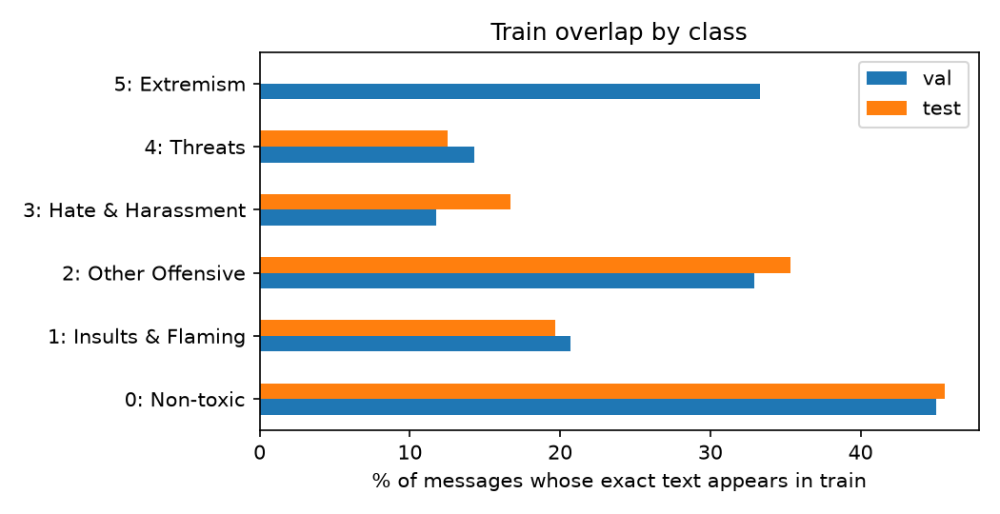
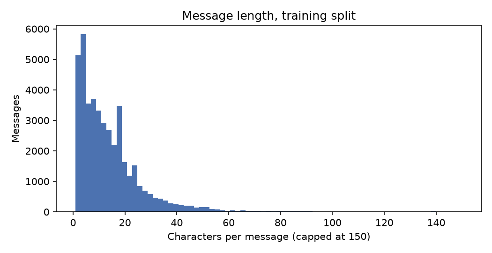
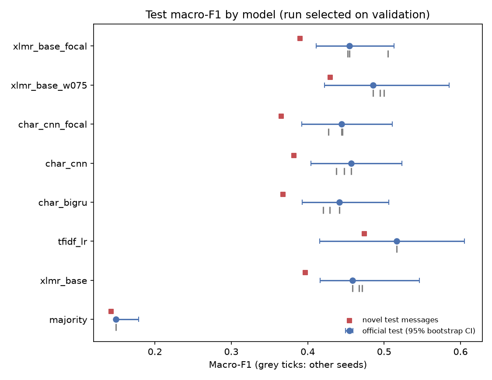
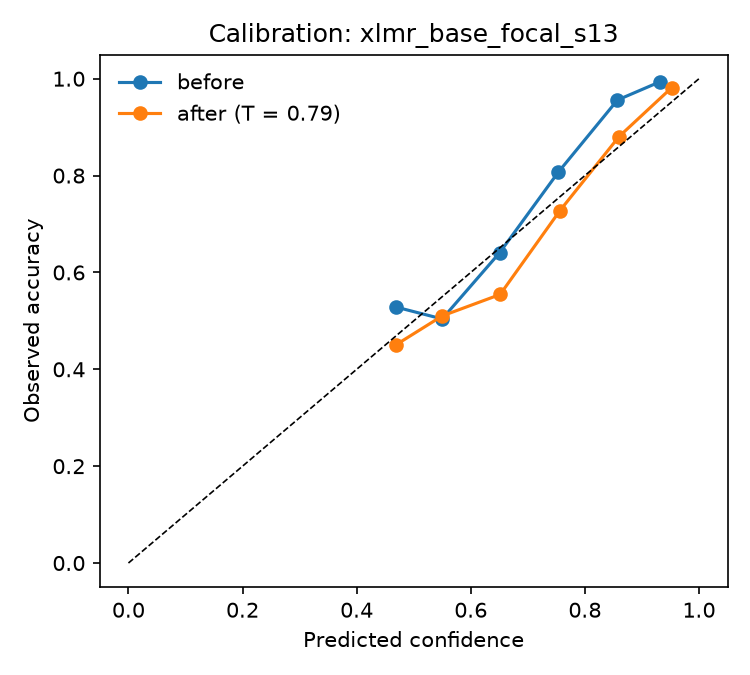

# Toxicity detection in game chat — full report

## 1. Data audit

### Data audit (Phase 0)

#### Overview

| split   |   messages |   unique_texts |   duplicate_rows_share |   median_chars |   p95_chars |   share_text_in_train |
|:--------|-----------:|---------------:|-----------------------:|---------------:|------------:|----------------------:|
| train   |      42959 |          27673 |                  0.356 |         10.000 |      38.000 |               nan     |
| val     |       5367 |           4108 |                  0.235 |         11.000 |      39.000 |                 0.409 |
| test    |       5375 |           4119 |                  0.234 |         10.000 |      40.000 |                 0.413 |

#### Class balance

|                      |   train |   val |   test |
|:---------------------|--------:|------:|-------:|
| 0: Non-toxic         |   34797 |  4349 |   4351 |
| 1: Insults & Flaming |    5925 |   740 |    742 |
| 2: Other Offensive   |    1874 |   234 |    235 |
| 3: Hate & Harassment |     279 |    34 |     36 |
| 4: Threats           |      60 |     7 |      8 |
| 5: Extremism         |      24 |     3 |      3 |

#### Overlap with the training split

Share of messages whose normalised text also appears in train. Short, repeated chat ('gg', 'lol') explains much of it; these messages can be classified by memorisation, so results are also reported on the novel subset.

|                      |   val |   test |
|:---------------------|------:|-------:|
| 0: Non-toxic         | 0.450 |  0.456 |
| 1: Insults & Flaming | 0.207 |  0.197 |
| 2: Other Offensive   | 0.329 |  0.353 |
| 3: Hate & Harassment | 0.118 |  0.167 |
| 4: Threats           | 0.143 |  0.125 |
| 5: Extremism         | 0.333 |  0.000 |

#### Annotation conflicts in train

299 distinct texts appear with more than one label (6,243 rows, 14.5% of train).

#### Most repeated messages in train

| Message | Count |
|---|---:|
| `gg` | 2,674 |
| `lol` | 381 |
| `nice` | 334 |
| `gj` | 293 |
| `wtf` | 177 |
| `cap` | 155 |
| `arty` | 152 |
| `xd` | 149 |
| `omg` | 148 |
| `ok` | 139 |
| `thx` | 139 |
| `#error!` | 137 |
| `sry` | 126 |
| `go` | 110 |
| `yes` | 98 |

#### Languages (langid; messages with ≥ 3 letters, otherwise 'short')

| lang   |   share |
|:-------|--------:|
| en     |   0.632 |
| short  |   0.143 |
| ru     |   0.029 |
| de     |   0.024 |
| pl     |   0.017 |
| it     |   0.015 |
| bg     |   0.015 |
| fr     |   0.015 |
| es     |   0.014 |
| sv     |   0.007 |
| da     |   0.007 |
| nl     |   0.006 |

#### CONDA (transfer set)

35,895 labelled utterances from 1,917 Dota 2 matches; 19.5% toxic (explicit or implicit).

## 2. Evaluation

### Evaluation

Runs are selected on **validation** macro-F1; test is only used to report. CIs are 95% percentile bootstrap over test messages.

#### Models (selected run per model)

| Model | Val macro-F1 | Test macro-F1 [95% CI] | Novel messages [95% CI] | Mean F1, 4 frequent classes | Binary AUROC |
|---|---:|---|---|---:|---:|
| xlmr_base_focal | 0.633 | 0.455 [0.411, 0.513] | 0.390 [0.359, 0.468] | 0.649 | 0.950 |
| xlmr_base_w075 | 0.626 | 0.485 [0.422, 0.585] | 0.429 [0.374, 0.512] | 0.651 | 0.951 |
| char_cnn_focal | 0.621 | 0.444 [0.392, 0.511] | 0.365 [0.332, 0.439] | 0.625 | 0.935 |
| char_cnn | 0.614 | 0.457 [0.404, 0.523] | 0.382 [0.347, 0.460] | 0.643 | 0.938 |
| char_bigru | 0.590 | 0.441 [0.392, 0.506] | 0.367 [0.339, 0.436] | 0.620 | 0.942 |
| tfidf_lr | 0.584 | 0.517 [0.416, 0.605] | 0.474 [0.364, 0.571] | 0.613 | 0.941 |
| xlmr_base | 0.522 | 0.459 [0.416, 0.546] | 0.397 [0.367, 0.474] | 0.654 | 0.951 |
| majority | 0.149 | 0.149 [0.148, 0.179] | 0.143 [0.141, 0.171] | 0.224 | 0.500 |

#### Seeds vs test-set noise

`test_seed_sd`: variation from retraining with another seed. `test_boot_sd`: variation from the finite test set. If either is comparable to the gap between two models, the ranking is not reliable.

| model           |   n_seeds |   val_mean |   test_mean |   test_seed_sd |   test_boot_sd |   novel_mean |   bin_auroc |
|:----------------|----------:|-----------:|------------:|---------------:|---------------:|-------------:|------------:|
| xlmr_base_focal |         3 |      0.618 |       0.471 |          0.030 |          0.035 |        0.412 |       0.948 |
| char_cnn        |         3 |      0.608 |       0.447 |          0.010 |          0.029 |        0.372 |       0.935 |
| xlmr_base_w075  |         3 |      0.597 |       0.493 |          0.007 |          0.035 |        0.441 |       0.945 |
| char_cnn_focal  |         3 |      0.595 |       0.439 |          0.010 |          0.028 |        0.360 |       0.933 |
| char_bigru      |         3 |      0.587 |       0.430 |          0.010 |          0.029 |        0.357 |       0.940 |
| tfidf_lr        |         1 |      0.584 |       0.517 |        nan     |          0.051 |        0.474 |       0.941 |
| xlmr_base       |         3 |      0.501 |       0.466 |          0.007 |          0.032 |        0.403 |       0.952 |
| majority        |         1 |      0.149 |       0.149 |        nan     |          0.007 |        0.143 |       0.500 |

#### Paired bootstrap comparisons (same test messages)

| model_a              | model_b            |    diff |   ci_low |   ci_high |   p_value |
|:---------------------|:-------------------|--------:|---------:|----------:|----------:|
| xlmr_base_focal_s13  | tfidf_lr           | -0.0619 |  -0.1484 |    0.0347 |    0.3160 |
| xlmr_base_w075_s42   | tfidf_lr           | -0.0312 |  -0.1250 |    0.1250 |    0.7090 |
| char_cnn_focal_s2027 | tfidf_lr           | -0.0724 |  -0.1681 |    0.0284 |    0.2250 |
| char_cnn_s13         | tfidf_lr           | -0.0599 |  -0.1516 |    0.0394 |    0.3380 |
| char_bigru_s2027     | tfidf_lr           | -0.0753 |  -0.1673 |    0.0259 |    0.1820 |
| xlmr_base_s2027      | tfidf_lr           | -0.0581 |  -0.1494 |    0.0866 |    0.3910 |
| majority             | tfidf_lr           | -0.3675 |  -0.4562 |   -0.2588 |    0.0000 |
| xlmr_base_focal_s13  | xlmr_base_w075_s42 | -0.0308 |  -0.1221 |    0.0108 |    0.2190 |

#### Binary toxic vs non-toxic (all runs, including the generic model)

| model                                  |   bin_auroc |   bin_f1 |   bin_precision |   bin_recall |
|:---------------------------------------|------------:|---------:|----------------:|-------------:|
| xlmr_base                              |       0.952 |    0.792 |           0.774 |        0.811 |
| xlmr_base_focal                        |       0.948 |    0.793 |           0.769 |        0.819 |
| xlmr_base_w075                         |       0.945 |    0.797 |           0.779 |        0.815 |
| tfidf_lr                               |       0.941 |    0.765 |           0.715 |        0.823 |
| char_bigru                             |       0.940 |    0.751 |           0.766 |        0.737 |
| char_cnn                               |       0.935 |    0.760 |           0.770 |        0.751 |
| char_cnn_focal                         |       0.933 |    0.757 |           0.765 |        0.750 |
| generic_multilingual_toxic_xlm_roberta |       0.835 |    0.611 |           0.665 |        0.564 |
| generic_toxic_bert                     |       0.797 |    0.605 |           0.678 |        0.546 |
| majority                               |       0.500 |    0.320 |           0.191 |        1.000 |

#### Detailed analysis: `xlmr_base_focal_s13` (best on validation)

##### Per class

| class             |   test_support |    f1 |
|:------------------|---------------:|------:|
| Non-toxic         |           4351 | 0.940 |
| Insults & Flaming |            742 | 0.738 |
| Other Offensive   |            235 | 0.431 |
| Hate & Harassment |             36 | 0.486 |
| Threats           |              8 | 0.133 |
| Extremism         |              3 | 0.000 |

Classes with a handful of test examples make macro-F1 very noisy: one message more or less correct moves the score by several points.

##### Per language (langid, groups with ≥ 50 test messages)

| language   |    n |   toxic_share |   macro_f1 |   binary_auroc |
|:-----------|-----:|--------------:|-----------:|---------------:|
| en         | 3385 |         0.204 |      0.493 |          0.958 |
| ru         |  149 |         0.275 |      0.424 |          0.833 |
| pl         |   87 |         0.218 |      0.547 |          0.967 |
| de         |  124 |         0.234 |      0.379 |          0.905 |
| short      |  757 |         0.025 |      0.496 |          0.939 |
| other      |  855 |         0.257 |      0.490 |          0.904 |

##### Calibration

Temperature fitted on validation: T = 0.79. Expected calibration error on test: 0.065 before, 0.034 after.

##### Moderation policy (thresholds chosen on validation)

Auto-action: precision ≥ 95% on validation. Human review: the remaining band needed to reach 90% recall of toxic messages.

| band         |   threshold |   share_of_messages |   precision |   share_of_toxic_caught |
|:-------------|------------:|--------------------:|------------:|------------------------:|
| auto-action  |       0.997 |               0.001 |       0.800 |                   0.004 |
| human review |       0.395 |               0.263 |       0.643 |                   0.888 |
| missed       |     nan     |               0.736 |     nan     |                   0.108 |

## 3. Cross-game transfer

### Cross-game transfer: World of Tanks → Dota 2 (CONDA)

35,895 labelled Dota 2 messages from 1,917 matches, 19.5% toxic (explicit or implicit). No CONDA label is used for training or thresholds; the oracle column is only a reference.

AUROC CIs resample whole matches (cluster bootstrap).

| model                                  |   conda_auroc |   conda_auroc_ci_low |   conda_auroc_ci_high |   conda_f1_gametox_threshold |   conda_f1_oracle_threshold |   recall_explicit |   recall_implicit |   false_positive_rate |   gametox_test_auroc |
|:---------------------------------------|--------------:|---------------------:|----------------------:|-----------------------------:|----------------------------:|------------------:|------------------:|----------------------:|---------------------:|
| xlmr_base                              |         0.827 |                0.818 |                 0.836 |                        0.632 |                       0.639 |             0.847 |             0.114 |                 0.077 |                0.952 |
| xlmr_base_focal                        |         0.827 |                0.818 |                 0.836 |                        0.631 |                       0.643 |             0.863 |             0.126 |                 0.085 |                0.948 |
| xlmr_base_w075                         |         0.814 |                0.806 |                 0.824 |                        0.632 |                       0.634 |             0.842 |             0.108 |                 0.074 |                0.945 |
| char_bigru                             |         0.812 |                0.804 |                 0.822 |                        0.605 |                       0.610 |             0.786 |             0.100 |                 0.072 |                0.940 |
| generic_toxic_bert                     |         0.806 |                0.797 |                 0.815 |                        0.621 |                       0.623 |             0.811 |             0.118 |                 0.072 |                0.797 |
| char_cnn_focal                         |         0.794 |                0.785 |                 0.804 |                        0.599 |                       0.601 |             0.766 |             0.093 |                 0.068 |                0.933 |
| generic_multilingual_toxic_xlm_roberta |         0.786 |                0.777 |                 0.795 |                        0.571 |                       0.573 |             0.702 |             0.088 |                 0.062 |                0.835 |
| char_cnn                               |         0.776 |                0.766 |                 0.786 |                        0.569 |                       0.580 |             0.690 |             0.075 |                 0.055 |                0.935 |
| tfidf_lr                               |         0.756 |                0.744 |                 0.771 |                        0.604 |                       0.607 |             0.822 |             0.135 |                 0.092 |                0.941 |

`gametox_test_auroc` is the same binary task in the original game: the drop to `conda_auroc` measures how much is lost when moving to another game. A large gap between the GameTox-threshold F1 and the oracle F1 means the scores still rank messages well but the threshold does not transfer.
