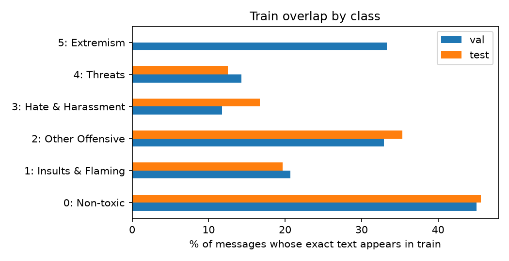
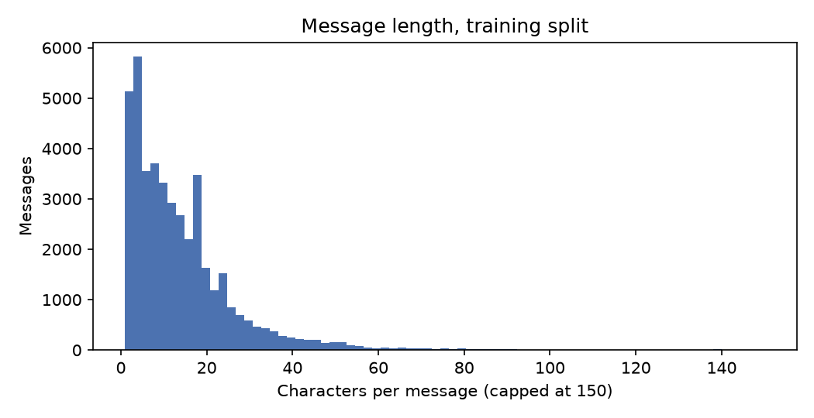

# Data audit (Phase 0)

## Overview

| split   |   messages |   unique_texts |   duplicate_rows_share |   median_chars |   p95_chars |   share_text_in_train |
|:--------|-----------:|---------------:|-----------------------:|---------------:|------------:|----------------------:|
| train   |      42959 |          27673 |                  0.356 |         10.000 |      38.000 |               nan     |
| val     |       5367 |           4108 |                  0.235 |         11.000 |      39.000 |                 0.409 |
| test    |       5375 |           4119 |                  0.234 |         10.000 |      40.000 |                 0.413 |

## Class balance

|                      |   train |   val |   test |
|:---------------------|--------:|------:|-------:|
| 0: Non-toxic         |   34797 |  4349 |   4351 |
| 1: Insults & Flaming |    5925 |   740 |    742 |
| 2: Other Offensive   |    1874 |   234 |    235 |
| 3: Hate & Harassment |     279 |    34 |     36 |
| 4: Threats           |      60 |     7 |      8 |
| 5: Extremism         |      24 |     3 |      3 |

## Overlap with the training split

Share of messages whose normalised text also appears in train. Short, repeated chat ('gg', 'lol') explains much of it; these messages can be classified by memorisation, so results are also reported on the novel subset.

|                      |   val |   test |
|:---------------------|------:|-------:|
| 0: Non-toxic         | 0.450 |  0.456 |
| 1: Insults & Flaming | 0.207 |  0.197 |
| 2: Other Offensive   | 0.329 |  0.353 |
| 3: Hate & Harassment | 0.118 |  0.167 |
| 4: Threats           | 0.143 |  0.125 |
| 5: Extremism         | 0.333 |  0.000 |

## Annotation conflicts in train

299 distinct texts appear with more than one label (6,243 rows, 14.5% of train).

## Most repeated messages in train

| Message | Count |
|---|---:|
| `gg` | 2,674 |
| `lol` | 381 |
| `nice` | 334 |
| `gj` | 293 |
| `wtf` | 177 |
| `cap` | 155 |
| `arty` | 152 |
| `xd` | 149 |
| `omg` | 148 |
| `ok` | 139 |
| `thx` | 139 |
| `#error!` | 137 |
| `sry` | 126 |
| `go` | 110 |
| `yes` | 98 |

## Languages (langid; messages with ≥ 3 letters, otherwise 'short')

| lang   |   share |
|:-------|--------:|
| en     |   0.632 |
| short  |   0.143 |
| ru     |   0.029 |
| de     |   0.024 |
| pl     |   0.017 |
| it     |   0.015 |
| bg     |   0.015 |
| fr     |   0.015 |
| es     |   0.014 |
| sv     |   0.007 |
| da     |   0.007 |
| nl     |   0.006 |

## CONDA (transfer set)

35,895 labelled utterances from 1,917 Dota 2 matches; 19.5% toxic (explicit or implicit).
