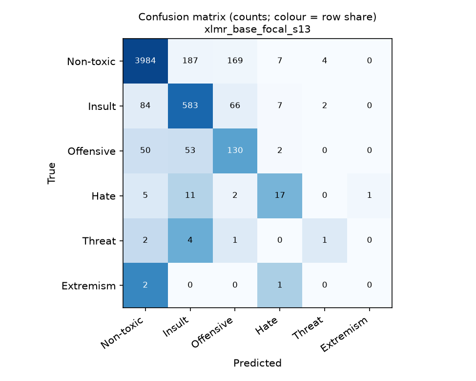

# Error analysis: `xlmr_base_focal_s13` (test set)

660 errors out of 5,375 messages (12.3%). Offensive words are masked automatically; review before publishing.

## Confusion matrix

|                |   pred Non-toxic |   pred Insult |   pred Offensive |   pred Hate |   pred Threat |   pred Extremism |
|:---------------|-----------------:|--------------:|-----------------:|------------:|--------------:|-----------------:|
| true Non-toxic |             3984 |           187 |              169 |           7 |             4 |                0 |
| true Insult    |               84 |           583 |               66 |           7 |             2 |                0 |
| true Offensive |               50 |            53 |              130 |           2 |             0 |                0 |
| true Hate      |                5 |            11 |                2 |          17 |             0 |                1 |
| true Threat    |                2 |             4 |                1 |           0 |             1 |                0 |
| true Extremism |                2 |             0 |                0 |           1 |             0 |                0 |

## Where the errors are

### By seen in train

| seen_in_train      |   messages |   error_rate |   toxic_share |   missed_toxic_rate |
|:-------------------|-----------:|-------------:|--------------:|--------------------:|
| novel text         |   3156.000 |        0.180 |         0.250 |               0.332 |
| text seen in train |   2219.000 |        0.042 |         0.106 |               0.131 |

### By lang group

| lang_group   |   messages |   error_rate |   toxic_share |   missed_toxic_rate |
|:-------------|-----------:|-------------:|--------------:|--------------------:|
| de           |    124.000 |        0.194 |         0.234 |               0.379 |
| en           |   3385.000 |        0.120 |         0.204 |               0.255 |
| other        |    873.000 |        0.183 |         0.259 |               0.296 |
| pl           |     87.000 |        0.138 |         0.218 |               0.421 |
| ru           |    149.000 |        0.255 |         0.275 |               0.537 |
| short        |    757.000 |        0.025 |         0.025 |               0.474 |

### By length

| length    |   messages |   error_rate |   toxic_share |   missed_toxic_rate |
|:----------|-----------:|-------------:|--------------:|--------------------:|
| 1-5 chars |   1587.000 |        0.051 |         0.086 |               0.212 |
| 6-15      |   1945.000 |        0.115 |         0.213 |               0.236 |
| 16-40     |   1591.000 |        0.175 |         0.241 |               0.326 |
| >40       |    252.000 |        0.302 |         0.353 |               0.461 |

### By conflicting in train

| conflicting_in_train   |   messages |   error_rate |   toxic_share |   missed_toxic_rate |
|:-----------------------|-----------:|-------------:|--------------:|--------------------:|
| False                  |   4623.000 |        0.129 |         0.195 |               0.309 |
| True                   |    752.000 |        0.084 |         0.161 |               0.116 |

## Missed toxicity (toxic predicted as non-toxic)

143 cases.

| Message (masked) | True | Predicted | Confidence | Lang |
|---|---|---|---:|---|
| `maybe shut up and go to garage` | Offensive | Non-toxic | 0.38 | en |
| `too salty, too salty xDD` | Offensive | Non-toxic | 0.57 | en |
| `I can‘t win anyway` | Offensive | Non-toxic | 0.56 | en |
| `report thsi udes` | Insult | Non-toxic | 0.64 | en |
| `we have mean players` | Offensive | Non-toxic | 0.89 | en |
| `dzięki za remis z***** w T71` | Insult | Non-toxic | 0.44 | pl |
| `mob` | Insult | Non-toxic | 0.60 | en |
| `look at ur IP address...... wrong server for u here` | Insult | Non-toxic | 0.55 | en |

## False alarms (non-toxic predicted as toxic), most confident first

367 cases.

| Message (masked) | True | Predicted | Confidence | Lang |
|---|---|---|---:|---|
| `k**` | Non-toxic | Threat | 0.96 | en |
| `f****** useless m*****` | Non-toxic | Insult | 0.88 | en |
| `СТ ПИДОРЫ` | Non-toxic | Hate | 0.87 | ru |
| `im creat cross fire you dumb f***** in arta` | Non-toxic | Insult | 0.87 | en |
| `Up the rigging yer monkeys` | Non-toxic | Insult | 0.86 | en |
| `пидорюга` | Non-toxic | Hate | 0.85 | uk |
| `mozogjál a kurva anyádba` | Non-toxic | Insult | 0.85 | hu |
| `You are r****** I am INvizible` | Non-toxic | Insult | 0.84 | ro |

## Right that it is toxic, wrong class

150 cases.

| Message (masked) | True | Predicted | Confidence | Lang |
|---|---|---|---:|---|
| `WEST EUROPE OVER, THE MUSLIMS EAT DINNERE` | Hate | Insult | 0.40 | en |
| `No, I just say he sucks` | Insult | Offensive | 0.67 | en |
| `heavies get to the top of the hill fast dont fkin stop to shoot get tot he top` | Offensive | Insult | 0.37 | en |
| `camping loser M4` | Offensive | Insult | 0.78 | es |
| `i will break every f***** bone in your useless bodies` | Threat | Insult | 0.88 | en |
| `und dann die heavys auf der line 2: schön warten bis der tod zu ihnen kommt...ihr kotzt mi` | Threat | Insult | 0.79 | de |
| `i f****** hate this mapo man` | Offensive | Insult | 0.56 | en |
| `ang go where ? out in the f****** open??` | Offensive | Insult | 0.55 | en |

## Errors in other languages

234 cases.

| Message (masked) | True | Predicted | Confidence | Lang |
|---|---|---|---:|---|
| `hat euhc euer vater zusehr das hrin aus dme a**** gevögelt` | Hate | Insult | 0.75 | de |
| `РОТ закрой щенок ебаный` | Non-toxic | Insult | 0.80 | ru |
| `трое на базу у них` | Insult | Non-toxic | 0.81 | sr |
| `доуя` | Hate | Non-toxic | 0.64 | uk |
| `damn` | Non-toxic | Offensive | 0.72 | sv |
| `рот ебав` | Offensive | Insult | 0.52 | mk |
| `pedobalnce` | Non-toxic | Insult | 0.51 | sl |
| `centur. udes ?` | Insult | Non-toxic | 0.86 | da |

## Most confident errors (candidates for label noise)

660 cases.

| Message (masked) | True | Predicted | Confidence | Lang |
|---|---|---|---:|---|
| `k**` | Non-toxic | Threat | 0.96 | en |
| `kill putin` | Extremism | Non-toxic | 0.94 | en |
| `gg ez` | Insult | Non-toxic | 0.94 | en |
| `ez` | Insult | Non-toxic | 0.93 | short |
| `bg` | Offensive | Non-toxic | 0.93 | short |
| `dont cry` | Offensive | Non-toxic | 0.91 | en |
| `прими пидор на роге` | Insult | Hate | 0.91 | mk |
| `s*** AND PRESS w yourself so your mate wont be focused ^^` | Offensive | Insult | 0.91 | en |

## Errors on texts that appear in train with different labels

63 cases.

| Message (masked) | True | Predicted | Confidence | Lang |
|---|---|---|---:|---|
| `afk` | Non-toxic | Offensive | 0.61 | en |
| `no support` | Non-toxic | Offensive | 0.75 | it |
| `omfg` | Non-toxic | Offensive | 0.62 | en |
| `afk` | Non-toxic | Offensive | 0.61 | en |
| `what the hell` | Non-toxic | Offensive | 0.78 | en |
| `tf` | Non-toxic | Offensive | 0.57 | short |
| `bots` | Non-toxic | Insult | 0.75 | en |
| `or lose` | Non-toxic | Offensive | 0.69 | es |
